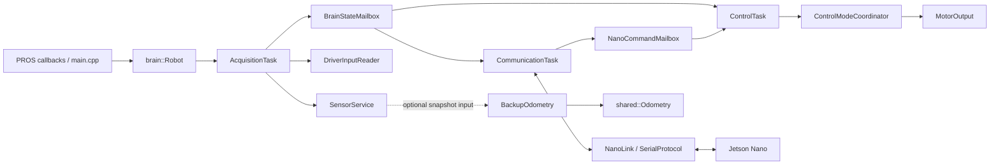

# V5 Brain Structure

This document describes the current V5 Brain control scaffold: where its code
lives, what its namespaces mean, and what each class or group of types is for.
The files define interfaces and responsibilities for implementation work; the
structure itself does not imply that the control algorithms are complete.

## Directory layout

```text
v5-brain/
├── include/
│   ├── constants.hpp                  Brain hardware ports and local constants
│   └── brain/
│       ├── robot.hpp                  Public application lifecycle interface
│       ├── types.hpp                  Brain modes, snapshots, and commands
│       ├── configuration.hpp          Brain-to-Nano configuration
│       ├── mailboxes.hpp              Cross-task state and command handoff
│       ├── sensors/                   Hardware sensor adapters and sampling
│       ├── control/                   Controller input, command selection, output
│       ├── tasks/                     Periodic acquisition, control, and link work
│       ├── communication/             Brain-side Nano serial adapter
│       ├── localization/              Optional Brain-side odometry adapter
│       └── diagnostics/               Error and log interfaces
└── src/
    ├── main.cpp                       PROS lifecycle callbacks
    ├── utils/shared.cpp               Shared implementation aggregation point
    └── brain/                         Matching implementation files

shared/include/
├── robotConfig.hpp                    Platform-neutral robot geometry
├── odometry.hpp                       Platform-neutral pose integration
└── serial/
    ├── packets.hpp                    Shared Brain-Nano wire packet definitions
    └── serialProtocol.hpp             Shared serial transport interface
```

The PROS, LVGL, and GIF headers under `v5-brain/include/` are platform or vendor
headers and are not part of the Brain application namespace structure.

## Namespaces

| Namespace | Purpose | Examples |
| --- | --- | --- |
| `brain` | V5 Brain application interfaces, data types, and adapters. Subfolders organize files; most Brain classes remain directly in this namespace. | `brain::Robot`, `brain::SensorService`, `brain::ControlTask` |
| `brain::constants` | Physical ports and constants used only by the V5 Brain. | `brain::constants::IMU_PORT` |
| `shared` | Platform-neutral geometry, pose, odometry, and other code shared by Brain and Nano. | `shared::RobotConfig`, `shared::Odometry` |
| `packets` | Wire-format packet types shared by the Brain and Nano serial protocol. | `packets::ConfigFixed`, `packets::CommandFixed` |
| `pros` | PROS-provided hardware and runtime APIs. | `pros::Controller`, `pros::MotorGroup` |

Directory names such as `brain::sensors` or `brain::tasks` are not additional
namespace boundaries in the current interfaces. For example, `Encoder` is
`brain::Encoder`, declared in `brain/sensors/encoder.hpp`. This keeps the type
names concise while the include paths group files by responsibility.

## Brain interfaces and data types

### Application entry and composition

- **`brain::Robot`** (`brain/robot.hpp`) is the public lifecycle facade. It
  exposes initialization, mode changes, execution of a competition mode, and
  shutdown. Its private `Components` implementation hides the set of runtime
  objects owned by the application.
- **`main.cpp`** owns one process-lifetime `brain::Robot` and forwards the PROS
  callbacks to it: `initialize()` initializes it, `disabled()` selects
  `RobotMode::Disabled`, `autonomous()` runs `RobotMode::Autonomous`, and
  `opcontrol()` runs `RobotMode::Manual`. This keeps PROS entry points as
  application wiring rather than control logic.
- **`brain::BrainConfiguration`** (`brain/configuration.hpp`) collects Brain
  configuration that is sent to the Nano. It can refer to shared robot
  geometry, while Brain-only physical wiring stays in `constants.hpp`.

### Data exchanged by the system

`brain/types.hpp` contains value types used between Brain components:

- **`RobotMode`** identifies Disabled, Autonomous, or Manual operation.
- **`DriverInput`** is a snapshot of the master controller's input.
- **`MotorGroupTelemetry`** and **`TrackingWheelTelemetry`** describe acquired
  motor and tracking-wheel readings.
- **`SensorSnapshot`** groups readings from the Brain's physical sensors.
- **`BrainState`** is the combined state published for other Brain tasks and
  communication.
- **`MotorCommandMode`**, **`MotorGroupCommand`**, and **`MotorCommand`** describe
  requested motor outputs.
- **`NanoCommand`** carries a motor command received from the Nano.

The mailbox classes in `brain/mailboxes.hpp` provide latest-value handoffs
between concurrent tasks: **`BrainStateMailbox`** publishes and reads
`BrainState`, and **`NanoCommandMailbox`** publishes and reads `NanoCommand`.

### Sensor acquisition

- **`brain::Encoder`** (`brain/sensors/encoder.hpp`) adapts a PROS rotation
  sensor and exposes cached position, change, connection state, update, and
  reset operations.
- **`brain::TrackingWheel`** (`brain/sensors/trackingWheel.hpp`) associates an
  encoder with wheel geometry and exposes accumulated distance and distance
  change.
- **`brain::SensorService`** (`brain/sensors/sensorService.hpp`) samples the
  configured physical sensors and returns a `SensorSnapshot`.
- **`brain::AcquisitionTask`** periodically reads `SensorService` and
  `DriverInputReader`, assembles a `BrainState`, and publishes it through
  `BrainStateMailbox`.

The controller reader lives under `control/` because it reads operator input,
not a physical sensor.

### Control and motor output

- **`brain::DriverInputReader`** (`brain/control/driverInputReader.hpp`) adapts
  the PROS master controller to a `DriverInput` snapshot.
- **`brain::ManualControl`** (`brain/control/controlPolicy.hpp`) maps driver
  input to a motor command.
- **`brain::ControlModeCoordinator`** selects the command source for the
  current robot mode using Brain state, driver input, and Nano-link health.
- **`brain::MotorOutput`** (`brain/control/motorOutput.hpp`) adapts abstract
  motor commands to the configured PROS motor groups and provides a stop
  operation.
- **`brain::ControlTask`** periodically reads the latest state and Nano
  command, selects the applicable command through the coordinator, and applies
  it through `MotorOutput`.

### Nano communication

- **`brain::NanoLink`** (`brain/communication/nanoLink.hpp`) is the Brain-side
  adapter over the shared `SerialProtocol`. It sends Brain configuration and
  exchanges Brain state for a Nano response. **`brain::LinkExchange`** describes
  the result of one exchange.
- **`brain::CommunicationTask`** periodically performs link exchanges and
  publishes received Nano commands through `NanoCommandMailbox`.
- **`packets`** in `shared/include/serial/packets.hpp` defines the common wire
  structures. Transport and packet definitions are shared so each project
  uses the same protocol contract.

### Localization and diagnostics

- **`brain::BackupOdometry`** (`brain/localization/backupOdometry.hpp`) adapts
  Brain sensor snapshots to the platform-neutral `shared::Odometry` and
  provides an optional local pose estimate.
- **`shared::Pose`**, **`shared::OdometrySample`**, and **`shared::Odometry`**
  (`shared/include/odometry.hpp`) represent pose, tracking deltas, and the
  platform-neutral integration operation.
- **`brain::ErrorCode`**, **`brain::ErrorEvent`**, and **`brain::LogRecord`** are
  diagnostic data types. **`brain::ErrorReporter`** reports runtime errors,
  while **`brain::Logger`** accepts records and flushes them to the configured
  destination.

## Intended control flow



At a high level, PROS calls into `Robot`; the Brain gathers sensor and
controller input into a published state; the control task combines that state
with the current mode and any Nano command before sending a command to the
motor output adapter. The communication task exchanges state and commands with
the Nano. Backup odometry is a separate optional local estimate based on Brain
sensor data. Exact task rates, fallback policy, and control algorithms belong
to the implementation work for those interfaces.

## Where constants belong

- Put V5 Brain port assignments and Brain-only constants in
  `v5-brain/include/constants.hpp` under `brain::constants`.
- Put physical dimensions or values required by both Brain and Nano in the
  shared configuration (`shared/include/robotConfig.hpp`).
- Keep serial wire values and layouts in the shared `packets` definitions so
  both ends follow the same protocol.

This separates device wiring from robot geometry and from the bytes exchanged
over serial.
